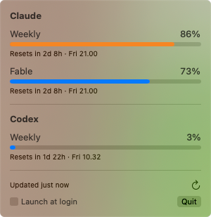

# AIUsage

A macOS menu bar app that shows how much of your AI subscription limits you have used, for Claude and OpenAI Codex.



## What it shows

The menu bar item shows the percentage of your Claude weekly limit that you have used, as a two-character number without a percent sign, such as `86`. Values below 10 have a leading zero (`09`), and 100 or more show `XX`, so the item keeps the same width. It is plain text in the menu bar's own colour, and VoiceOver reads the real number, such as "Claude weekly usage 86%" or "Claude weekly usage 100%". The app has no Dock icon. Click the number to open a small panel with one section per provider.

The item keeps showing the latest weekly number after an error, such as a 429, a network problem, a Keychain problem or an expired token, even when the panel dims or hides its rows. It shows a gauge icon instead only when the app has not fetched a number yet in this session, and when Claude is not set up. It shows only the "Weekly" limit, not "Fable" or other model limits.

Each limit has a row with:

- its name, such as "Weekly", "Fable" or "5-hour"
- the percentage used, with a bar coloured by severity
- when it resets, both relative ("in 2d 4h") and absolute ("Fri 21:00")

The panel shows every limit that the API returns, so a new window, such as a 5-hour limit, appears without a code change. The bar colour comes from the API's severity when it has one. When it doesn't, the bar turns orange at 75% and red at 90%.

The app refreshes every 5 minutes. It also refreshes when you open the panel and the data is more than a minute old. The panel has no Refresh button. After HTTP 429 or 5xx responses, the app waits before it asks again, from 5 minutes up to an hour, or as long as the server's `Retry-After` header says. Opening the panel doesn't skip that wait.

## Providers

### Claude

The app calls `GET https://api.anthropic.com/api/oauth/usage`, the undocumented endpoint that [claudeusage](https://github.com/maragubot/claudeusage) also uses. It authenticates with the OAuth token that Claude Code keeps in the login Keychain, in the item `Claude Code-credentials`. You must be logged in to Claude Code with a Claude subscription.

If the token has expired, the panel tells you to open Claude Code, which refreshes the token.

### Codex

The app calls `GET https://chatgpt.com/backend-api/wham/usage` with the ChatGPT login that the Codex CLI keeps in `~/.codex/auth.json` (or `$CODEX_HOME/auth.json`). The app looks for the CLI at `~/.local/bin/codex`, `/opt/homebrew/bin/codex` and `/usr/local/bin/codex`. If it can't find `auth.json` or the CLI, it hides the Codex section.

If the Codex login has expired, the panel shows a "Refresh Codex login" button. When you click it:

1. The app starts `codex app-server` and asks it to refresh its own token (`account/read` with `refreshToken: true`). This doesn't use any of your Codex usage.
2. If the usage endpoint still rejects the login after that, the app runs `codex login`, which opens the sign-in page in your browser.

Neither step runs unless you click the button.

## Install

You need macOS 15 or later and Swift 6.2 or later, from Xcode or the Command Line Tools. The build uses only `swift build`; there is no Xcode project.

```sh
script/install
```

The script:

1. builds a release binary
2. assembles `AIUsage.app` (bundle ID `dk.maragu.aiusage`, no Dock icon)
3. signs it with your first "Apple Development" identity, or ad hoc if you have none
4. copies it to `/Applications` and launches it, quitting any running copy first

`script/install --build` only builds and signs `.build/AIUsage.app`. `VERSION=1.2.3 script/install` sets the version.

Run the tests with `swift test`.

Turn on "Launch at login" in the panel to start the app when you log in.

## Keychain access

The app reads the `Claude Code-credentials` item with `/usr/bin/security find-generic-password -w`, as claudeusage does. Claude Code writes the item with the same `security` tool, so macOS lets that tool read it without a prompt.

The app doesn't use the Keychain API for this. Each time Claude Code refreshes its token, it updates the item, and that update removes the "Always Allow" that macOS stored for any other app. An app that reads the item directly therefore gets a new Keychain prompt after every token refresh.

You don't normally see a Keychain prompt. If macOS does show one, for example to unlock a locked keychain, the app waits 60 seconds for an answer. After that it shows "Reading the Keychain took too long" and tries again later, with a longer wait each time. If you click "Deny", the app shows "Keychain access was denied" and asks again later, with a longer wait each time.

The panel says the token expired only when its expiry time in the Keychain item has passed, or when the API rejects it with HTTP 401. A Keychain error has its own message.

## Credential safety

The app reads credentials that belong to other tools, so it handles them carefully:

- **Read only.** The app never writes the Keychain item, its access settings or `auth.json`, and it never refreshes a token itself. Claude Code rotates its token, and a Codex refresh token works only once, so a refresh from another app could log those tools out. The app only asks Codex to refresh its own login, and only when you click the button.
- **Re-read on every refresh.** The app reads credentials again for each request and keeps them in memory only for that request.
- **Sent only to the provider.** Tokens go only to `api.anthropic.com` and `chatgpt.com` over HTTPS. The app refuses redirects, so a token can't be sent anywhere else, and it doesn't store cookies or cache responses.
- **No secrets in logs.** The app logs with `os.Logger` under the subsystem `dk.maragu.aiusage`. It records only the provider, the HTTP status and an error category, and never tokens, headers or response bodies. Each refresh logs a `refresh` line and then one `fetch ok` or `fetch failed` line per provider. To read the log:

  ```sh
  /usr/bin/log show --predicate 'subsystem == "dk.maragu.aiusage"' --last 1h
  ```

  Use the full path `/usr/bin/log`, because in zsh `log` is a shell builtin. `swift test` logs under the same subsystem, so add `AND process == "AIUsage"` to the predicate to see only the app.

- **No telemetry and no third-party dependencies.**

## Adding a provider

Write one new type that conforms to `UsageProvider` in `Sources/AIUsageKit/Usage/UsageProvider.swift`, and add it to the provider list in `Sources/AIUsage/AIUsageApp.swift`. A provider has a name and returns a list of limits, each with a name, the percentage used, and an optional reset date and severity.

## Licence

MIT. See [LICENSE](LICENSE).
